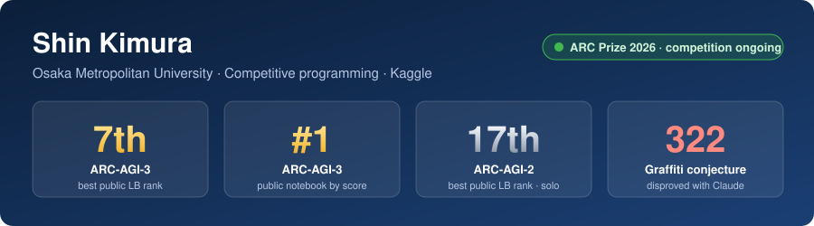
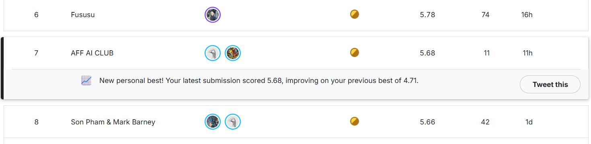
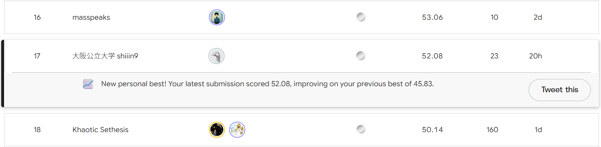
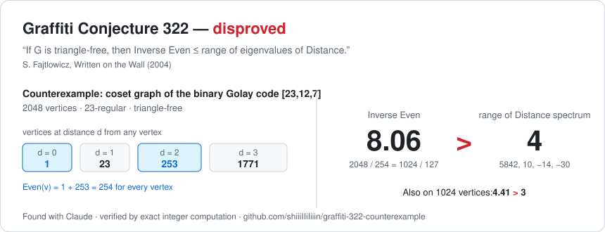

## Shin Kimura（木村心）

大阪公立大学の学生です。競技プログラミングでプログラミングをはじめ、2026年9月から Kaggle をはじめました。IT 企業でソフトウェアエンジニアとしてアルバイトもしています。 
A student at Osaka Metropolitan University. I started programming through competitive programming, and started Kaggle in September 2026. I also work part-time as a software engineer at an IT company.

### 実績 / Highlights

> ARC Prize 2026 は**競技中**です（2026年10月時点）。順位は公開リーダーボードのもので、最終順位ではありません。 
> ARC Prize 2026 is **still running** (as of October 2026). Ranks are from the public leaderboard, not final standings.

- **ARC Prize 2026 — ARC-AGI-3**：公開LB **全体最高7位**、公開ノートブックでパブリックスコア **1位**（チーム） 
  Best **7th overall** on the public leaderboard, **#1 public notebook** by public score (team) → [arc-prize-2026-arc-agi-3](https://github.com/shiiiIIiIiiin/arc-prize-2026-arc-agi-3)
- **ARC Prize 2026 — ARC-AGI-2**：公開LB **全体最高17位**（個人） 
  Best **17th overall** on the public leaderboard (solo) → [arc-prize-2026-arc-agi-2](https://github.com/shiiiIIiIiiin/arc-prize-2026-arc-agi-2)
- **数学の未解決問題**：Claude に未解決問題を探させて、まとめて解かせました（Graffiti 予想） 
  Had Claude find open problems and solve a batch of them (Graffiti conjectures) → [graffiti-results](https://github.com/shiiiIIiIiiin/graffiti-results)

### Links

[Kaggle](https://www.kaggle.com/shiiin9)

### Leaderboard

**ARC-AGI-3 — 7th**（2026-09-09）

**ARC-AGI-2 — 17th**（2026-10-15）

画像をクリックすると画面全体のスクリーンショットを開きます / Click an image for the full screenshot.

### Graffiti Conjecture 322

<a href="https://github.com/shiiiIIiIiiin/graffiti-322-counterexample"> 3 = range of Distance spectrum, on the 1024-vertex coset graph of the punctured Golay code" width="860"></a>
